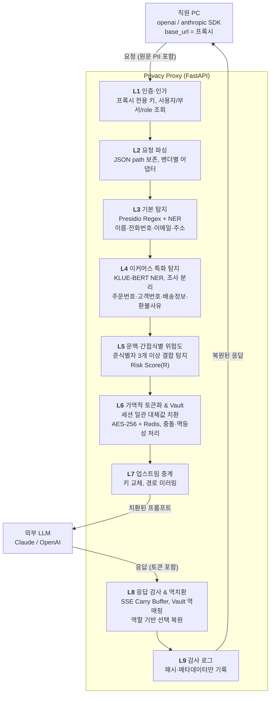

# privacy-proxy

Presidio 기반 LLM 프롬프트 개인정보 가명화 프록시 서비스.
직원이 쓰던 OpenAI/Anthropic SDK의 `base_url`만 바꾸면, 프롬프트 속 개인정보를 탐지·치환해 외부 LLM에 보내고 응답을 원문으로 되돌린다.

## 문제 상황

이커머스·금융상담 현장의 상담원은 고객 문의를 그대로 복사해 LLM에 붙여넣는다. 그 안에는 이름, 전화번호, 주소, 주문번호, 환불 사유가 섞여 있다. 온프레미스 LLM을 구축할 여력이 있는 대기업은 이 문제를 인프라로 해결하지만, 중소기업(SME)은 외부 LLM API를 쓸 수밖에 없다.

이 프로젝트는 그 사이에 프록시를 놓는다. 애플리케이션 코드는 그대로 두고 엔드포인트만 교체하며, **원본 개인정보는 프록시 경계를 넘어가지 않는다(Zero exposure)**. 원문과 토큰의 매핑은 서버 내부 Vault에만 존재한다.

## 파이프라인



원문 PII가 존재하는 구간은 L1~L6과 L8~L9뿐이다. L7에서 외부로 나가는 페이로드에는 토큰만 남는다.

### 레이어별 담당

| 레이어 | 내용 | 담당 |
| --- | --- | --- |
| L1 | 인증·인가 — 프록시 전용 키 검증, 사용자/부서/role 조회 | 공통 (프록시 스켈레톤) |
| L2 | 요청 파싱 — JSON path 보존, 벤더별 어댑터 | 공통 (프록시 스켈레톤) |
| L3 | 기본 탐지 — Presidio Regex + NER Recognizer | 정민우 |
| L4 | 이커머스 특화 탐지 — KLUE-BERT NER, 조사 분리, Custom Recognizer | 이선학 |
| L5 | 문맥·간접식별 위험도 — 준식별자 결합 탐지, Risk Score 산출 | 형지원 |
| L6 | 가역적 토큰화 & Vault — 세션 일관 치환, AES-256 Redis | 윤채림 |
| L7 | 업스트림 중계 — 키 교체, 경로 미러링 | 공통 (하네스 엔지니어링) |
| L8 | 응답 검사 & 역치환 — SSE Carry Buffer, 역할 기반 선택 복원 | 김민석 |
| L9 | 감사 로그 — 원문/매핑 미저장, 해시·메타데이터만 | 김민석 |

## 용어

치환 과정은 **가역적 토큰화(reversible tokenization)**로 표기한다. 개인정보보호법 제28조의5는 가명처리된 정보의 재식별을 금지하는데, 이 서비스는 응답 역치환(원문 복원)이 핵심 기능이므로 법령상 "가명처리"와는 다른 처리로 구분해 기술한다.

## 기술 스택

- Python 3.11+ / FastAPI / uvicorn
- Presidio (Analyzer, Anonymizer), KLUE-BERT, spaCy
- Redis (Vault), AES-256
- AWS (ECS/EC2, ElastiCache, KMS, Secrets Manager)
- uv, ruff, pytest, pre-commit, GitHub Actions

## 로컬 개발 환경 세팅

> 현재 저장소는 문서만 있는 초기 상태다. 아래 명령이 참조하는 `pyproject.toml`, `docker-compose.yml`, `.env.example`은 프록시 스켈레톤이 `develop`에 올라간 뒤 동작한다.

**1. 의존성 설치** — [uv](https://docs.astral.sh/uv/) 필요

```bash
uv sync
```

**2. pre-commit 훅 등록** (최초 1회)

```bash
uv run pre-commit install
```

**3. 환경 변수 설정**

```bash
cp .env.example .env
```

`.env`에 채울 값:

| 변수 | 설명 |
| --- | --- |
| `PROXY_API_KEY` | 직원 PC가 프록시에 붙을 때 쓰는 전용 키 |
| `ANTHROPIC_API_KEY` | 업스트림 Claude 호출용 (L7에서 교체 주입) |
| `OPENAI_API_KEY` | 업스트림 OpenAI 호출용 |
| `REDIS_URL` | Vault 접속 주소 (기본 `redis://localhost:6379/0`) |
| `VAULT_ENCRYPTION_KEY` | Vault AES-256 키 (32바이트, base64) |
| `LOG_LEVEL` | 기본 `INFO` |

`.env`는 커밋하지 않는다.

**4. Redis Vault 기동**

```bash
docker compose up -d
```

**5. 서버 실행**

```bash
uv run uvicorn privacy_proxy.main:app --reload --port 8000
```

**6. 동작 확인**

```bash
curl -X POST http://localhost:8000/v1/messages -H "Content-Type: application/json" -H "x-api-key: $PROXY_API_KEY" -d '{"model":"claude-sonnet-5","max_tokens":256,"messages":[{"role":"user","content":"홍길동 고객님(010-1234-5678) 주문 20240115-A1B2 환불 문의"}]}'
```

**7. 로컬 검사**

```bash
uv run ruff check . && uv run ruff format --check . && uv run pytest
```

## 프로젝트 구조

L1~L9에 1:1로 대응하는 구조를 제안한다.

```
privacy-proxy/
├── src/privacy_proxy/
│   ├── main.py                  # FastAPI 앱, 라우터 등록
│   ├── config.py                # 환경 변수 로딩
│   ├── pipeline.py              # L1~L9 오케스트레이션
│   ├── auth/                    # L1 인증·인가
│   │   ├── keys.py              #    프록시 전용 키 검증
│   │   └── directory.py         #    사용자/부서/role 조회
│   ├── adapters/                # L2 요청 파싱
│   │   ├── base.py              #    JSON path 보존 공통 인터페이스
│   │   ├── anthropic.py         #    Anthropic Messages API 어댑터
│   │   └── openai.py            #    OpenAI Chat Completions 어댑터
│   ├── detection/
│   │   ├── base/                # L3 기본 탐지 (정민우)
│   │   │   ├── analyzer.py      #    Presidio Analyzer 구성
│   │   │   └── recognizers/     #    이름·전화번호·이메일·주소
│   │   └── ecommerce/           # L4 이커머스 특화 탐지 (이선학)
│   │       ├── klue_ner.py      #    KLUE-BERT NER 연동
│   │       ├── alignment.py     #    spaCy 어절 정렬, 조사 분리
│   │       └── recognizers/     #    주문번호·고객번호·배송정보·환불사유
│   ├── risk/                    # L5 문맥·간접식별 위험도 (형지원)
│   │   ├── quasi_identifiers.py #    준식별자 정의
│   │   ├── combination.py       #    3개 이상 결합 탐지
│   │   └── score.py             #    Risk Score(R) 산출, 등급별 정책
│   ├── vault/                   # L6 가역적 토큰화 & Vault (윤채림)
│   │   ├── tokenizer.py         #    세션 일관 대체값 생성
│   │   ├── crypto.py            #    AES-256 암복호화
│   │   ├── store.py             #    Redis 저장소
│   │   └── collision.py         #    충돌 회피·멱등성
│   ├── upstream/                # L7 업스트림 중계
│   │   ├── relay.py             #    경로 미러링
│   │   └── credentials.py       #    키 교체 주입
│   ├── restore/                 # L8 응답 검사 & 역치환 (김민석)
│   │   ├── sse_buffer.py        #    SSE Carry Buffer
│   │   ├── detokenizer.py       #    Vault 역매핑
│   │   └── policy.py            #    역할 기반 선택 복원
│   └── audit/                   # L9 감사 로그 (김민석)
│       ├── logger.py            #    해시·메타데이터만 기록
│       └── schema.py            #    감사 레코드 스키마
├── tests/
│   ├── unit/                    # 레이어별 단위 테스트
│   ├── integration/             # 파이프라인 통합 테스트
│   └── fixtures/                # 가상 PII 데이터 (실제 개인정보 금지)
├── docs/
│   ├── ARCHITECTURE.md
│   └── decisions/               # 설계 결정 기록(ADR)
├── .github/workflows/ci.yml
├── docker-compose.yml           # Redis Vault
├── pyproject.toml
├── .env.example
├── .pre-commit-config.yaml
├── CONTRIBUTING.md
└── README.md
```

## 개발 규칙

- 실제 개인정보는 어떤 형태로도 커밋하지 않는다. 테스트 데이터는 반드시 가상값을 쓴다.
- 감사 로그에 원문과 매핑을 남기지 않는다. 해시와 메타데이터만 기록한다.
- 커밋 전 ruff, pytest 통과 필수.
- 주요 설계 결정은 `docs/decisions/`에 기록한다.

## 기여 방법

브랜치 전략, 커밋 메시지 규칙, PR 절차는 [CONTRIBUTING.md](CONTRIBUTING.md)를 참고한다.

## 문서

- 아키텍처: [docs/ARCHITECTURE.md](docs/ARCHITECTURE.md)
- 설계 결정 기록: [docs/decisions/](docs/decisions/)
