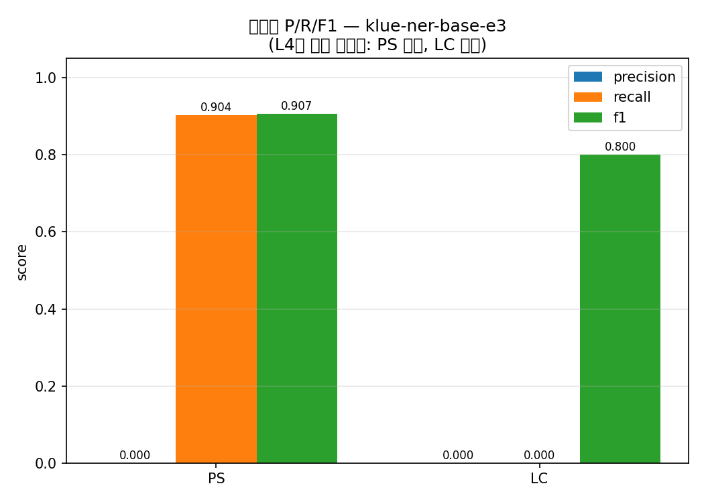
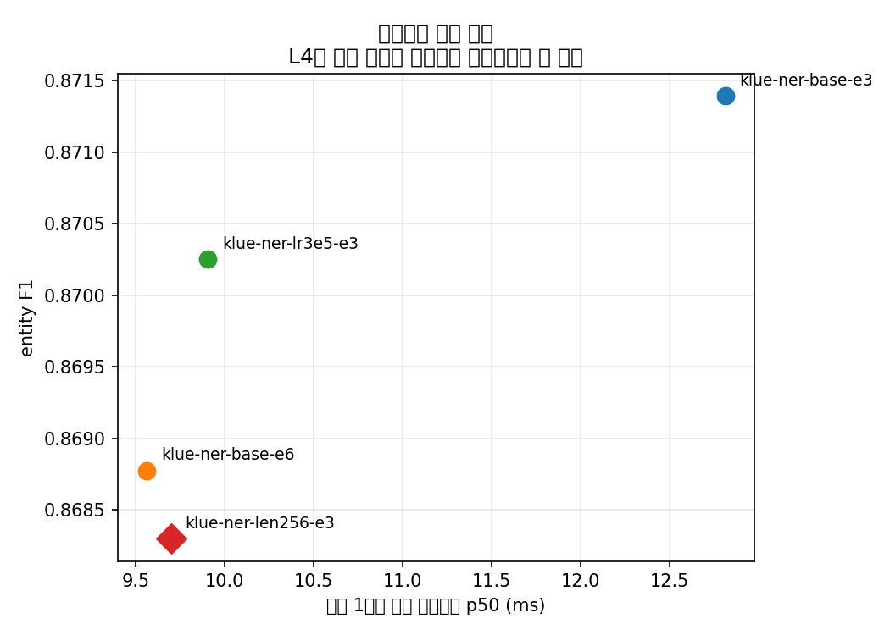

# KLUE-NER 1차 학습 결과

- 일자: 2026-09-06
- 실행 환경: Google Colab, Tesla T4, fp16
- 베이스 모델: `klue/bert-base` (NER 헤드 없음 → 여기서 새로 학습)
- 데이터: KLUE-NER (train 21,008 / validation 5,000, test split 없음)
- 코드: `l4/ner/`, 노트북 `l4/colab/klue_ner_train_colab.ipynb`

## 지표

| run | lr | epoch | max_len | entity F1 | precision | recall | PS f1 | PS recall | LC f1 | 지연 p50 | 학습 |
| --- | --- | --- | --- | --- | --- | --- | --- | --- | --- | --- | --- |
| **klue-ner-base-e3** | 5e-5 | 3 | 512 | **0.8714** | 0.8660 | 0.8768 | 0.9068 | 0.9036 | 0.8001 | 12.8ms | 521s |
| klue-ner-base-e6 | 5e-5 | 6 | 512 | 0.8688 | 0.8634 | 0.8742 | 0.9062 | 0.9070 | 0.7875 | 9.6ms | 975s |
| klue-ner-lr3e5-e3 | 3e-5 | 3 | 512 | 0.8703 | 0.8619 | 0.8788 | 0.9073 | 0.9072 | 0.7956 | 9.9ms | 495s |
| klue-ner-len256-e3 | 5e-5 | 3 | 256 | 0.8683 | 0.8622 | 0.8744 | 0.9023 | 0.8981 | 0.7902 | 9.7ms | 487s |

원본: [summary.csv](summary.csv), run별 [metrics.json](klue-ner-base-e3/metrics.json) ·
[log_history.csv](klue-ner-base-e3/log_history.csv)


주 지표는 seqeval **엔티티 F1**(문자 F1 아님). 파이프라인이 span 단위로 동작하므로
'김철수'를 '김철'로 잡으면 '수'가 원문에 남아 유출된다. 부분 점수를 주면 안 된다.

## 평가 경로 상한 = 0.9814

정답을 그대로 파이프라인에 통과시켜 측정한 값이다. **1.0이 아니다.**

서브워드 토크나이저가 이름과 조사를 한 토큰으로 묶으면(`'스타뎀의'`, `'##은이'`)
모델이 경계를 낼 방법 자체가 없다. 이 구조적 한계가 1.86%p다.

따라서 F1은 **1.0이 아니라 0.9814 대비**로 읽는다.

| | 값 | 상한 대비 |
| --- | --- | --- |
| entity F1 | 0.8714 | 88.8% |
| PS recall | 0.9036 | 93.0% |

## 판단

### 1. 성공 기준 0.8을 넘었다

0.8714. 학습 설정에 문제는 없다.

### 2. epoch 3이 최적점이고, 그 이상은 과적합이다

최종 F1만 보면 4개 run의 편차가 0.31%p라 노이즈처럼 보인다. 하지만 epoch별
추이를 보면 그렇지 않다.

| epoch | base-e6 F1 | base-e6 eval_loss |
| --- | --- | --- |
| 1 | 0.8563 | 0.0809 |
| 2 | 0.8668 | 0.0767 |
| **3** | **0.8721** | 0.0879 |
| 4 | 0.8684 | 0.1082 |
| 5 | 0.8672 | 0.1204 |
| 6 | 0.8688 | **0.1361** |

**epoch 3에서 F1이 정점을 찍고, 이후 eval_loss가 단조 증가한다.** 노이즈가 아니라
명확한 과적합이다. epoch을 늘리는 것은 학습 시간만 2배(521s → 975s) 쓰고 성능은
떨어뜨린다.

lr 3e-5도 F1 0.8703으로 차이가 없다(5e-5와 0.11%p).

**추가 하이퍼파라미터 탐색은 의미가 없다.** `klue-ner-base-e3`를 기준선으로 확정한다.
성능을 올릴 여지는 하이퍼파라미터가 아니라 다른 데 있다(아래 4번).

### 2-1. epoch 2가 F1은 더 높지만 epoch 3을 쓴다

`base-e3`의 epoch별 추이다.

| epoch | F1 | PS recall |
| --- | --- | --- |
| 1 | 0.8584 | 0.8945 |
| 2 | **0.8729** | 0.8911 |
| 3 | 0.8714 | **0.9036** |

F1은 epoch 2가 0.15%p 높지만 **PS recall은 epoch 3이 1.25%p 높다.**
L4에서 인명 누락은 곧 개인정보 유출이므로 **PS recall을 우선해 epoch 3을 쓴다.**
이 트레이드오프는 P3에서도 같은 기준으로 판단한다.

### 2-2. LC(지명) F1이 0.80으로 낮다

PS(인명) F1이 0.9068인 데 비해 LC는 0.8001이다. 전체 F1을 끌어내리는 주된 원인이
지명 쪽이다.

L4에서 지명은 배송지 탐지에 쓰이므로 무시할 수 없지만, 인명만큼 치명적이지는 않다
(주소 단독으로는 개인 식별이 어렵고, L5의 준식별자 결합 판정이 받는다).
P3에서 이커머스 배송지 표현을 학습시키면 개선될 여지가 크다.



### 3. len256은 예상대로 차이가 없었다

KLUE-NER 문장은 최대 145자라 256에서도 512에서도 잘리지 않고, dynamic padding이라
실제 연산량이 같다. **"차이 없음"이 결과다.**

지연시간도 마찬가지다. `base-e3`만 12.8ms로 튀는데, 이건 max_length 때문이 아니라
**첫 run이라 GPU 클럭 부스트가 덜 걸린 측정 아티팩트**로 보인다(나머지 3개는
9.6~9.9ms로 균일). 워밍업 10건이 부족했을 수 있다. 지연시간을 진지하게 비교하려면
워밍업을 늘리고 run 순서를 섞어 재측정해야 한다.

L4의 지연시간을 실제로 줄이려면 다른 축이 필요하다 — 동적 int8 양자화,
더 작은 인코더(`klue/roberta-small`), 배치 처리.



### 4. ⚠️ PS recall 0.9036 — 인명의 9.6%를 놓친다

**L4에서 가장 중요한 숫자다.** 1,000건 중 약 96건의 이름이 탐지되지 않고
그대로 외부 LLM으로 나간다는 뜻이다.

PII 프록시로서 이 수치는 충분하지 않다. 다만 L4 단독으로 판단할 문제는 아니다.

- L3(Presidio 정규식)와 함께 동작하면 겹치는 부분이 커버된다
- L5(준식별자 결합 위험도)가 백스톱 역할을 한다
- 남은 격차의 일부는 조사 경계(상한 1.86%p)이며 `alignment/`가 회수한다

**P3 도메인 파인튜닝의 목표를 이 수치로 잡는다.** 전체 F1이 아니라 PS recall이
개선 대상이다.

## 조사 경계 진단 (`check_josa.py`)

성능 지표와 별개로, `alignment/` 설계 입력으로 수집했다.

| 입력 | 예측 span | 판정 |
| --- | --- | --- |
| `김철수에게` / `김철수가` / `김철수는` | `김철수` | 정상 |
| `송하은 고객님` | `송하은` | 정상 |
| `송하은은 어제 주문했어요` | `송하은` | **정상 — ko-pii가 '송하'로 깨지던 케이스** |
| `김지은이 문의했습니다` | `김지은이` | **실패 — 조사 '이' 포함** |

### `김지은이`만 실패한 이유는 토크나이저다

```
김지은이  →  김지[0,2] | ##은이[2,4]        ← 토큰이 이름/조사 경계를 가로지름
송하은은  →  송[0,1] ##하[1,2] ##은[2,3] ##은[3,4]   ← 경계가 토큰 경계와 일치
```

`##은이`가 [2,4]를 한 덩어리로 덮어서 모델이 (0,3)을 낼 방법이 없다.
모델의 판단 실패가 아니라 표현력의 한계다.

### `alignment/` 판별 규칙 (다음 주)

두 케이스가 정반대 처리를 요구한다. `김지은이`는 `이`를 떼야 하고,
`송하은`은 `은`을 떼면 안 된다. 조사 사전만으로는 구분할 수 없다
(ko-pii가 실패하는 지점). **토큰 경계가 판별자가 된다.**

```
span 끝 == 토큰 경계   → 모델이 의도적으로 자른 것. NER을 신뢰      (송하은)
span 끝이 토큰 중간    → 모델이 자를 수 없었던 것. 조사 사전 적용   (김지은이)
```

## 이커머스 문맥 관찰

| 입력 | 결과 |
| --- | --- |
| `박민준님 ...` | `박민준` (PS) — `님` 제외, 정상 |
| `최우진씨가 ...` | `최우진` (PS) — `씨가` 제외, 정상 |
| `이서연 고객이 서울 강남구로 ...` | `서울 강남구` (LC) — **공백 포함 엔티티 정상 처리 확인** |
| `주문번호 20240115-A3F9` | `20240`(QT) + `9`(QT)로 조각남, 가운데 미탐지 |
| `010-0000-0000` | 미탐지 (KLUE-NER에 전화번호 태그 없음. L3 담당) |

### 주문번호 조각남이 주는 시사점 둘

1. **NER은 주문번호를 못 잡는다.** P2의 Custom Recognizer(정규식)가 필요하다는 확증.
2. **`L4_ENTITY_TYPES`를 PS·LC로 제한한 결정이 옳았다.** QT를 썼다면 주문번호가
   저렇게 조각나 오탐이 됐을 것이다. `어제`(DT)도 같은 이유로 쓰지 않는다.

## 다음 단계

1. `alignment/` — 위 판별 규칙으로 조사 경계 중재 (다음 주)
2. P2 — 이커머스 Custom Recognizer(주문번호·고객번호 정규식), 병합 정책
3. P3 — 도메인 파인튜닝. **목표 지표는 PS recall**

## 원본 파일

| 파일 | 내용 |
| --- | --- |
| `summary.csv` | 4개 run 비교 (전체 지표 + 지연시간 + 학습 시간) |
| `<run>/metrics.json` | run별 전체 지표, 하이퍼파라미터, 지연시간 |
| `<run>/log_history.csv` | epoch별 loss·F1·PS recall 추이 |
| `figures/*.png` | 위 그림 3장 |

가중치(`model/`, 430MB)는 저장소에 없다. GitHub 100MB 제한에 걸리고 `.gitignore`로
막혀 있다. Google Drive `privacy-proxy/l4-ner/klue-ner-base-e3/model/` 에 있으며,
`alignment/` 작업 시 로컬 `outputs/klue-ner-base-e3/model/` 로 받아두면
`l4/ner/predict.py` 가 그대로 사용한다.

## 재현

```bash
uv sync --extra training
uv run python -m l4.ner.experiments --only klue-ner-base-e3
```

Colab은 `l4/colab/README.md` 참고. 로컬 CPU에서는 run 하나에 약 3.8시간이 걸린다
(GPU 대비 지연시간도 9.3배: CPU 90ms vs GPU 9.7ms).
