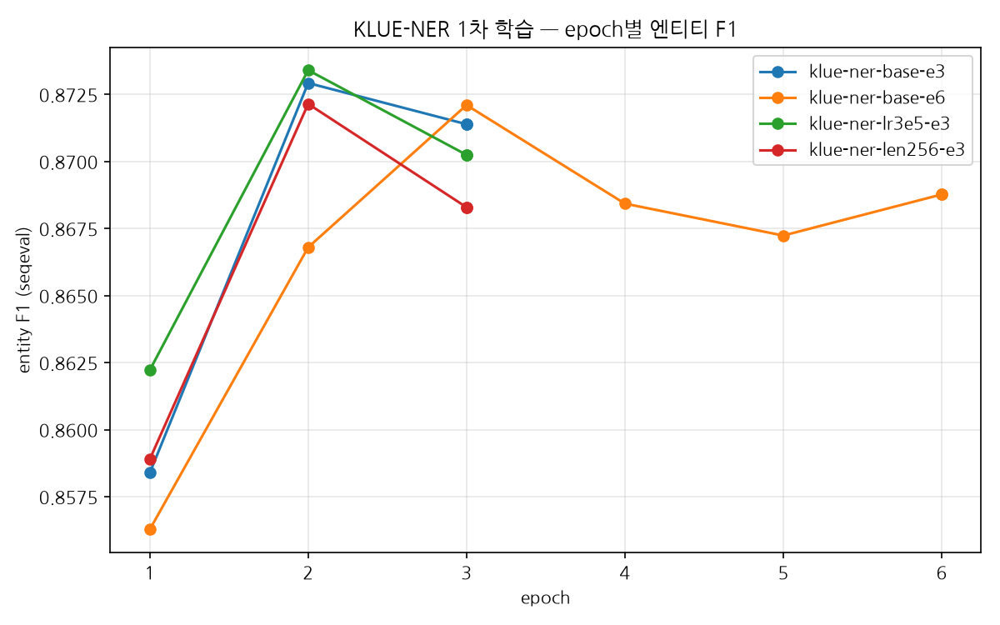

# KLUE-NER 1차 학습 결과 및 베이스라인 리포트

- **일자**: 2026-09-06
- **환경**: Google Colab (Tesla T4, fp16)
- **베이스 모델**: `klue/bert-base` (사전학습 인코더에 Token Classification 헤드 추가 학습)
- **데이터셋**: KLUE-NER (train 21,008 / validation 5,000, test split 미제공으로 validation 기준 평가)
- **코드**: `l4/ner/`, 노트북 `l4/colab/klue_ner_train_colab.ipynb`

## 1. 실험 지표 요약

| Run | lr | epoch | max_len | Entity F1 | Precision | Recall | PS F1 | **PS Recall** | LC F1 | 지연(p50) | 학습 시간 |
| :--- | :---: | :---: | :---: | :---: | :---: | :---: | :---: | :---: | :---: | :---: | :---: |
| **`klue-ner-base-e3`** | 5e-5 | 3 | 512 | **0.8714** | 0.8660 | 0.8768 | 0.9068 | **0.9036** | 0.8001 | 12.8ms | 521s |
| `klue-ner-base-e6` | 5e-5 | 6 | 512 | 0.8688 | 0.8634 | 0.8742 | 0.9062 | 0.9070 | 0.7875 | 9.6ms | 975s |
| `klue-ner-lr3e5-e3` | 3e-5 | 3 | 512 | 0.8703 | 0.8619 | 0.8788 | 0.9073 | 0.9072 | 0.7956 | 9.9ms | 495s |
| `klue-ner-len256-e3` | 5e-5 | 3 | 256 | 0.8683 | 0.8622 | 0.8744 | 0.9023 | 0.8981 | 0.7902 | 9.7ms | 487s |

* 원본 데이터: [summary.csv](summary.csv), Run별 [metrics.json](klue-ner-base-e3/metrics.json) · [log_history.csv](klue-ner-base-e3/log_history.csv)



> **평가 기준 주의사항:** 문자 단위 F1이 아니라 `seqeval` **엔티티 F1**을 사용함. 파이프라인이 텍스트 Span 단위로 마스킹하므로, '김철수'를 '김철'로 부분 인식하면 남은 '수'가 유출됨. 보안 파이프라인 특성상 부분 일치 점수는 배제함.

---

## 2. 이론적 상한선 (0.9814)

정답 라벨을 파이프라인 변환 로직에 그대로 통과시켰을 때 측정된 최대 상한선은 **0.9814**임 (1.0 도달 불가).

* **원인:** WordPiece 토크나이저가 이름과 조사를 한 토큰으로 묶는 경우(`스타뎀의`, `##은이`), 모델 레이어에서 경계를 물리적으로 분리할 방법이 없음. 이로 인한 구조적 손실이 약 1.86%p 발생함.
* **실질 성능:** 단순 1.0 기준이 아니라 **이론상 상한선(0.9814) 대비**로 평가해야 함.

| 지표 | 측정값 | 상한선 대비 달성률 |
| :--- | :---: | :---: |
| Entity F1 | 0.8714 | 88.8% |
| **PS Recall** | **0.9036** | **93.0%** |

---

## 3. 결과 분석 및 모델 선정 근거

### 목표치(0.80) 달성
Entity F1 기준 0.8714로 1차 목표선(0.80)을 안정적으로 넘김. 전반적인 학습 파이프라인 세팅 정상 확인.

### Epoch 3을 최적점으로 확정 (과적합 구간 확인)
최종 F1만 보면 4개 Run 간 편차가 0.31%p 수준이라 차이가 없어 보이지만, Epoch별 손실 추이를 보면 양상이 다름.

| Epoch | base-e6 F1 | base-e6 eval_loss | 비고 |
| :---: | :---: | :---: | :--- |
| 1 | 0.8563 | 0.0809 | |
| 2 | 0.8668 | 0.0767 | |
| **3** | **0.8721** | **0.0879** | **최적점** |
| 4 | 0.8684 | 0.1082 | eval_loss 반등 시작 |
| 5 | 0.8672 | 0.1204 | |
| 6 | 0.8688 | 0.1361 | 과적합 심화 |

Epoch 3에서 F1 정점을 찍은 뒤 `eval_loss`가 계속 상승함. Epoch을 더 늘리면 학습 시간만 2배(521s → 975s)로 늘고 모델만 과적합됨. lr(3e-5 vs 5e-5) 역시 성능 차이가 0.11%p로 미미하여, **추가 하이퍼파라미터 튜닝 대신 `klue-ner-base-e3`를 베이스라인으로 확정**함.

### F1 대신 PS Recall 기준으로 Epoch 3 선택
`base-e3` 내부 추이 비교:
* **Epoch 2**: F1 0.8729 / PS Recall 0.8911
* **Epoch 3**: F1 0.8714 / **PS Recall 0.9036**

Epoch 2가 F1은 0.15%p 높지만, **PS Recall은 Epoch 3이 1.25%p 더 높음.** 인명 누락(FN)은 곧바로 LLM 프롬프트 유출 사고로 이어지므로, F1 손실을 감수하고 **재현율이 가장 높은 Epoch 3**을 채택함.

### LC(지명) F1 저조 (0.8001)
PS(0.9068) 대비 LC F1이 0.8001로 낮아 전체 수치를 깎아먹음. 지명은 배송지 주소 탐지에 쓰이지만 인명만큼 단독 식별 위험이 크진 않음(L5 결합 판정에서 보완 가능). 추후 P3 단계에서 이커머스 배송지 표현을 추가 학습시켜 보완할 예정.


### Max Length(256 vs 512) 영향 없음
KLUE-NER 텍스트 길이가 최대 145자라 256 토큰 내에 전부 들어옴. dynamic padding 환경이라 연산량과 성능 차이가 발생하지 않음.

지연시간의 경우 `base-e3`만 12.8ms로 높게 나왔는데, 첫 번째 실행으로 인한 GPU Warm-up 부족 이슈로 판단됨 (나머지 run은 9.6~9.9ms 유지). 런타임 레이턴시 최적화는 추후 ONNX 변환, int8 양자화, 경량 인코더 검토로 풀 예정.


### ⚠️ PS Recall 0.9036에 대한 해석
현재 수치상 인명의 약 9.6%를 놓치고 있음. 단독 모델로는 부족하지만 아래 다층 방어로 커버함:
1. L3(정규식/호칭 룰)와 교차 탐지
2. L5 준식별자 결합 위험도 평가에서 2차 차단
3. 조사 결합으로 잃어버린 수치는 `alignment.py`가 일부 회수함 (PS Recall 0.9036 → 0.9101,
   아래 "`alignment.py` 적용 전/후" 참고)
따라서 P3 도메인 파인튜닝의 최우선 지표를 전체 F1이 아닌 **PS Recall 개선**으로 잡음.

---

## 4. 조사 경계 이슈 분석 (`check_josa.py`)

샘플 테스트 결과, 모델 추론 결함이 아닌 **토크나이저 어휘 분해 단위의 한계**가 명확히 드러남.

| 입력 문장 | 모델 예측 Span | 상태 | 분해 양상 |
| :--- | :--- | :---: | :--- |
| `김철수에게` / `김철수가` / `김철수는` | `김철수` | 정상 | 조사 분리 정상 |
| `송하은 고객님` | `송하은` | 정상 | 호칭 분리 정상 |
| `송하은은 어제 주문했어요` | `송하은` | **정상** | '송하은' 정상 보존 (`ko-pii` 오류 케이스 해결) |
| `김지은이 문의했습니다` | `김지은이` | **오류** | 조사 '이'가 엔티티에 포함됨 |

### 토크나이저 분해 비교

```text
김지은이  →  김지[0,2] | ##은이[2,4]        ← 토큰이 이름/조사 경계를 가로지름
송하은은  →  송[0,1] ##하[1,2] ##은[2,3] ##은[3,4]   ← 경계와 토큰 끝이 정확히 일치
```

`##은이`가 `[2, 4]` 구간을 통째로 물고 있어 모델 입장에서는 `(0, 3)` 경계를 잘라낼 물리적 방법이 없음.

### `alignment/` 후처리 판별 규칙 (4주차 구현)
단순 조사 사전을 돌리면 '김지은이'는 고쳐도 '송하은은'의 '은'까지 잘라버리는 문제가 생김. **토큰 경계 매핑 여부**로 분기를 나눔.

```text
1. Span 끝 == 토큰 경계  → 모델이 의도적으로 분리한 것. NER 경계 신뢰 ('송하은' 보존)
2. Span 끝 != 토큰 경계  → 토크나이저 한계로 물린 것. 조사 사전 매칭으로 잘라냄 ('김지은이' → '이' 제거)
```

### `alignment.py` 적용 전/후 (2026-09-07)

위 판별 규칙(토큰 경계)대로 구현하고, `klue-ner-base-e3`를 재학습 없이 다시 채점함.
`l4/ner/evaluate_alignment.py`가 validation 로짓을 한 번만 뽑아서 `apply_josa=False`/
`True` 양쪽으로 돌린 결과임.

| 지표 | 적용 전 | 적용 후 | 상한(0.9814) 대비 |
| --- | --- | --- | --- |
| entity F1 | 0.8713 | 0.8740 | 0.8905 |
| **PS recall** | 0.9033 | **0.9101** | **0.9274** |
| l4 F1 | 0.8777 | 0.8825 | 0.8993 |
| l4 recall | 0.8805 | 0.8853 | 0.9021 |

PS recall이 +0.68%p로 제일 많이 오름. 조사 경계 중재가 이름(PS) 끝에 붙는 은/는/이/가
같은 것들을 떼는 로직이니 당연한 결과임. LC는 지명 조사가 상대적으로 드물어서 F1
상승 폭이 더 작음.

전/후 F1(0.8713→0.8740)이 위 지표 표의 base-e3 수치(0.8714)와 소수점 셋째 자리에서
갈리는데, 이건 오차가 아니라 **fp16/fp32 차이임** — 학습 때 GPU에서 fp16으로 잰 값과
이번에 fp32로 다시 뽑은 로짓이 경계값에서 미세하게 다른 argmax를 냄. 큰 자릿수엔
영향 없음.

**PS recall 상한 대비 92.04% → 92.74%.** 남은 격차(=100% - 92.74% = 7.26%p)의 일부만
회수했다는 뜻임. 조사 경계가 전부는 아니고, 나머지는 모델 자체의 학습 부족(위 LC F1
저조, 도메인 미학습)이 더 큼. 그래도 **모델 재학습 없이, 후처리 한 단계로 공짜로 얻은
개선**이라 그대로 파이프라인에 둠.

원본: [alignment_eval.json](klue-ner-base-e3/alignment_eval.json)

---

## 5. 도메인 관찰 및 아키텍처 검증

| 입력 | 추출 결과 | 비고 |
| :--- | :--- | :--- |
| `박민준님 ...` | `박민준` (PS) | 호칭 '님' 제외 정상 |
| `최우진씨가 ...` | `최우진` (PS) | '씨가' 제외 정상 |
| `이서연 고객이 서울 강남구로 ...` | `서울 강남구` (LC) | 공백 포함 엔티티 정상 추출 |
| `주문번호 20240115-A3F9` | `20240`(QT) + `9`(QT) | 조각남, 가운데 결손 발생 |
| `010-0000-0000` | 미탐지 | KLUE-NER 라벨 없음 |

* **시사점:** NER 모델은 정형화된 주문번호나 전화번호를 안정적으로 잡지 못함.
* L4 엔티티를 `PS`, `LC`로 한정하고, 주문번호/전화번호 등은 **L3(Regex/Custom Recognizer)로 분리한 설계가 유효함**을 확인.

---

## 6. 4주차 진행 계획

1. ~~`alignment/` 모듈 단독 구현 및 검증~~ 완료
2. ~~L4 추론 경로 통합 및 지표 재측정~~ 완료. PS Recall +0.68%p(상한 대비 +0.70%p),
   위 "`alignment.py` 적용 전/후" 참고
3. **P3 파인튜닝 데이터 설계**
   * 배송지 주소 패턴 및 CS 인명 결합 데이터 구성 준비
   * 목표 지표는 PS Recall. 남은 격차는 조사 경계보다 LC 약세·도메인 미학습 쪽이 큼

---

## 7. 산출물 및 재현 환경

| 파일 | 설명 |
| :--- | :--- |
| `summary.csv` | 4개 Run 전체 지표 및 리소스 측정 비교표 |
| `<run>/metrics.json` | Run별 하이퍼파라미터 및 세부 메트릭 |
| `<run>/log_history.csv` | Epoch별 loss/F1/PS recall 상세 로그 |
| `figures/*.png` | 학습 곡선 및 지연시간 비교 그래프 |

> **가중치 파일 안내:**  
> 모델 가중치(`model/`, 약 430MB)는 용량 문제로 레포에 커밋하지 않고 Google Drive(`privacy-proxy/l4-ner/klue-ner-base-e3/model/`)에 보관함. 로컬 테스트 시 `outputs/klue-ner-base-e3/model/` 경로에 내려받으면 `l4/ner/predict.py`에서 즉시 로드 가능.

### 재현 명령어

```bash
uv sync --extra training
uv run python -m l4.ner.experiments --only klue-ner-base-e3
```
